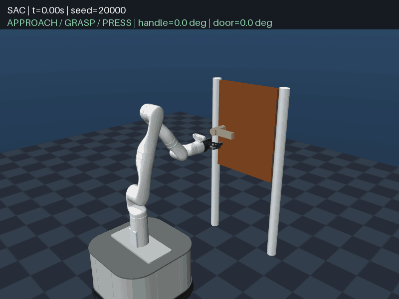

### 实现效果




2026-10-21 本次训练共 50 万步，最终选中 48 万步检查点。上图使用该模型的确定性动作，从 home 初始姿态开始连续录制，包含抓握、下压、拉门和成功保持，全程 333 步、6.66 秒，结尾停留 1 秒。种子为 20000，最终把手下压约 60°、门角约 21.4°。当前任务的成功标准是稳定抓握并下压达到 45°后，将门拉开至少 0.30 rad（约 17.2°），继续抓握保持 0.30 秒；动图展示到该任务终止时刻。

训练内评估为 5/5 成功，训练结束后的另一组初态评估为 4/5（80%），两者使用的初态不同。录制信息及模型/GIF 哈希见 [opening.json](assets/door_sac_2026-10-21/opening.json)。动图展示一个成功回合。

本次额外用 CPU、确定性动作和种子 90000..90099 复核 **100 回合，成功 95/100**，抓握率和下压率均为 100%；未成功的 5 回合中，3 回合超时、2 回合触发穿透失败。完整逐回合结果见 [evaluation_100.json](assets/door_sac_2026-10-21/evaluation_100.json)。这与 4/5 使用不同初态和样本量，不应将训练内的 5/5 解读为所有初态都能成功。

### 评估命令

从项目根目录执行，使用本次训练选出的最佳模型：

```powershell
# 100 回合评估，不显示窗口。
uv run --no-sync python train/train_sac_modular.py --evaluate runs/door_sac_staged/best/best_model.zip --episodes 100 --seed 90000 --device cpu

# 查看完整开门过程；第一个回合与上方 GIF 的初态相同。
uv run --no-sync python train/train_sac_modular.py --evaluate runs/door_sac_staged/best/best_model.zip --episodes 5 --seed 20000 --device cpu --render

# 使用本地模型重新生成 GIF。
uv run --no-sync python assets/door_sac_2026-10-21/record_gif.py
```

上述命令需要本地已有的 `runs/door_sac_staged/best/best_model.zip`；模型和经验回放不随本次动图一起上传。

另保留可视化训练入口 `train/train_sac_render.py`：加 `--render` 默认单环境，两个阶段都显示窗口；不加则默认 4 环境。原模块化入口保持不变。相关 54 项测试及真实窗口下的 CUDA 短程接续检查已通过。

### 算法简单构成
1. 读取参数
默认总训练 50 万步、4 个并行环境、随机种子 67。
2. 准备训练记录
检查输出目录为空，保存当前源码、模型 XML 和参数，方便复现。
3. 第一阶段：前 10 万步
从随机网络开始，用 SAC 学习。奖励重点引导抓住把手并下压；环境始终允许完成整个开门任务。
4. 第二阶段：后 40 万步
接续第一阶段配套保存的网络、优化器和经验回放。将持续下压奖励改成“下压进展奖励”，减少停留在压把手状态刷奖励的倾向，继续学习拉门。默认这一阶段使用 CPU。
5. 评估并保存结果
每 1 万步评估，每 2 万步保存周期模型和回放。最后按完整开门成功率选择模型，保存到输出目录的 best/best_model.zip。
具体配置参见[SAC_DOOR_SUCCESS_REPRODUCTION.md](docs/SAC_DOOR_SUCCESS_REPRODUCTION.md)
### 难点/解决方案
1. 如何设置合理的奖励函数去完成对机械臂的引导
课程学习Curriculum Learning的思想，分两段去做，第一段奖励下压，第二阶段奖励下压进度
2. 一开始完成1中的操作也不行
加两侧指垫相对于把手表面的误差、居中误差、指垫间距、闭合准备度和双侧接触程度。几何信息进入观测和奖励，由网络学习对应动作。（gpt真聪明
3. 当SAC算法容易陷入局部自举
经验池的初始经验增加到5000条
