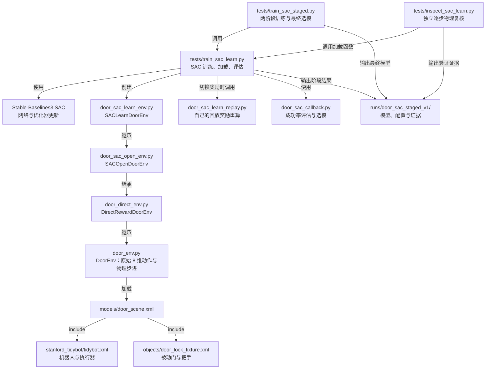
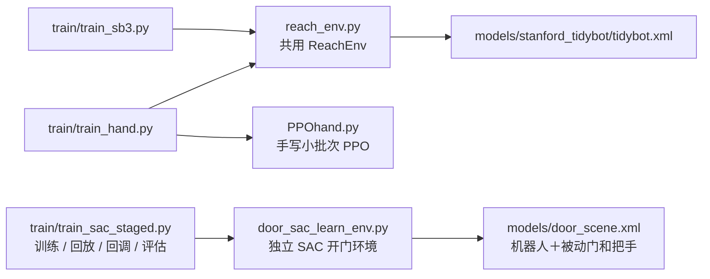

# RLInit

> **当前入口（2026-10-20 重构后）**：任务一使用 `train/train_hand.py` 或 `train/train_sb3.py`，任务二使用 `train/train_sac_staged.py`。
> 当前结构、可运行命令和迁移记录见文末的[重构后使用说明](#env-train-layout)。下方早期研发记录及“重构前”结构图保留作历史对照，其中旧 `tests/train*.py` 与根目录 `train.py` 命令已经迁移，不再作为现行入口。

### 路线（边做边改）
MuJoCo
│
├── MJCF / MjSpec      <geom mass="0"/>

│      ↓
│   搭建机器人和场景
│      <geom mass="0"/>

├── Physics Simulation
│      ↓
│ qpos / qvel / sensor / actuator
│
├── Gymnasium Environment
│      ↓
│ observation
│ action
│ reward
│ terminated / truncated
│
├── RL Algorithm
│      ↓
│ PPO / SAC / SAC+HER
│
├── Training
│      ↓
│ rollout → buffer → update → rollout...
│
├── Evaluation
│      ↓
│ success rate
│ return
│ sample efficiency
│
└── Robustness
       ↓
 observation noise
 mass/friction
 object position

1. 建模对象的选择和实现的控制任务
现在的想法有机器人-正确行走、果蝇-完成各种飞行任务、鸟-完成各种飞行任务、3自由度串联机械臂 + 两指夹爪+底座四轮完成开门关门这种contact-rich的任务
现在偏向的是最后一个
2. 从零搭建移动机械臂(已严肃放弃，东西太多了，直接使用google给出的stanford_tidybot模型)
3. 实现任务目标
先实现固定底盘，末端到达目标点（简单任务验证）
移动机械臂开门（final goal）
4. 建模为 MDP 过
先实现「固定底盘，末端到达目标点」，定义 `<S, A, P, R, γ>`，再扩展到开门任务。以下数值是初始参数，需根据仿真效果调整。
| 要素 | 到达任务的定义 |
| --- | --- |
| 状态 S | 完整物理状态、目标位置及影响下一步的控制器状态。策略观测先用 `[七个关节角, 七个关节角速度, 末端位置, 目标−末端位置]`，共 20 维；末端取 `pinch_site`。 |
| 动作 A | `a ∈ [-1, 1]^7`，映射为关节目标角 `q_target = clip(q_arm + 0.03a, 下限, 上限)`，写入七个机械臂位置执行器的 `data.ctrl`。限位需同时满足关节和执行器约束；无限位关节不能把默认 `[0, 0]` 当作限位。 |
| 转移 P | MuJoCo 根据状态和控制输入推进物理。每个动作保持 N 个物理步，控制周期为 `N × model.opt.timestep`；例如物理步长 0.002 s、N=10 时为 50 Hz。 |
| 奖励 R | 令动作执行后的末端距离为 `d = ||p_ee − g||₂`，使用 `r = −d − 0.001||a||₂² + 5 × 1[d < 0.02]`：鼓励接近目标、减小动作，到达 2 cm 内给予成功奖励。 |
| 折扣 γ | 训练算法中先设 `γ = 0.99`；控制周期变化时需重新考虑其对应的时间尺度。 |

```bash
uv sync --extra cpu
# 只显示模型初始姿态：
uv run --no-sync python scripts/view_robot.py
```

### 第一个任务：PPO 训练-先实现固定底盘，末端到达目标点（简单任务验证）
代码位于 `src/rlinit/algorithmhand/`：`reach_env.py` 实现上述到达任务，`PPO.py` 调用 [Stable-Baselines3 PPO](https://stable-baselines3.readthedocs.io/en/master/modules/ppo.html) 提供可复用的训练和评估函数，仓库根目录的 `train.py` 是实际运行入口，负责解析参数并调用这些函数。环境从 TidyBot XML 在内存中移除底盘和夹爪自由度，保留七个臂关节；原模型文件不变。第一版只以位置到达为成功条件，尚未加入碰撞失败判定或末端姿态要求。
在仓库根目录运行（以下以 CPU 环境为例；CUDA 环境安装方式见下文）：
```bash
uv sync --extra cpu
# 正式训练；步数会向上取整到完整 rollout，30 万步是初始预算。
uv run --no-sync python train.py --timesteps 300000
# 实时显示训练中的机械臂和绿色目标点。
uv run --no-sync python train.py --timesteps 300000 --render
# 短跑检查训练流程，不代表策略已经学会任务。
uv run --no-sync python train.py --timesteps 256 --n-steps 128 --batch-size 64 --output-dir runs/smoke
# 加载模型评估；增加 --render 可打开查看器观察策略。
uv run --no-sync python train.py --evaluate runs/reach_ppo/ppo_reach.zip --episodes 20
```
输出目录包含最终模型 `ppo_reach.zip`、训练日志 `train.monitor.csv`、配置 `config.json` 和独立评估指标 `metrics.json`（成功率、平均回报、平均最终距离）。每 10000 步或一个 rollout（取较大值）额外评估并保存 `best/best_model.zip`。训练结束自动进行 10 回合独立评估；是否学会任务以评估结果为准。

### 手写 PPO 训练
`tests/train_hand.py` 使用 `PPOhand.py`，通过 `PPO.from_env(env)` 自动读取观测和动作维度。每次收集 `--n-steps` 步后，先按时间顺序计算一次 GAE 和固定目标，再在每个 epoch 打乱样本，按 `--batch-size` 更新。默认每批 64 条，更新 10 轮；批内优势归一化，单条尾批跳过归一化，损失记录所有小批次的平均值。
```bash
# 短跑验证；加 --render 可观察训练。
uv run --no-sync python tests/train_hand.py --timesteps 256 --n-steps 128 --epochs 2
# 正式训练。
uv run --no-sync python tests/train_hand.py --timesteps 300000
# 加载手写 PPO 模型并渲染评估。
uv run --no-sync python tests/train_hand.py --evaluate runs/reach_ppohand/ppo_hand.pt --episodes 20 --render
```
默认输出到 `runs/reach_ppohand/`：模型 `ppo_hand.pt`、回合日志 `episodes.csv`、更新损失 `updates.csv`、配置及最终 10 回合独立评估指标。`.pt` 使用独立格式，不能与 Stable-Baselines3 的 `.zip` 互换；短跑只验证流程，不代表收敛。

手写 PPO 统一使用 `PPOhand.py`，默认双层 128 ReLU、打乱小批次更新；`--hidden-dim` 设置两层宽度，`--batch-size` 设置批大小。主版旧单层检查点仍可评估。

| 任务 | 手写 PPO 入口 | SB3 基准入口 |
| --- | --- | --- |
| 固定底盘到达 | `tests/train_hand.py` | `train.py` |
| 固定底盘开门 | `tests/trainp2_hand.py` | `tests/trainp2_sb3.py` |

手写 PPO 与 SB3 的训练结束后自动评估统一使用 `训练 seed + 20000` 作为首回合种子，之后每回合递增 1，默认评估 10 回合。该规则由 `src/rlinit/algorithmhand/evaluation.py` 统一定义；终端打印实际种子，`config.json` 的 `final_eval_seed` 字段记录该值。例如训练 `--seed 0` 时，自动评估的目标种子为 `20000` 到 `20009`。手动评估仍直接使用命令行 `--seed`。

### 两台设备：CPU / RTX 3060
两台设备共用 `pyproject.toml` 和 `uv.lock`，分别选择互斥的 PyTorch extra。`uv sync` 不检测显卡，应明确指定 `cpu` 或 `cuda`，不要同时启用两者（也不要使用 `--all-extras`）。配置方式见 [uv 官方 PyTorch 指南](https://docs.astral.sh/uv/guides/integration/pytorch/#configuring-accelerators-with-optional-dependencies)。
```bash
# 本机无 NVIDIA GPU：安装 CPU 版 PyTorch。
uv sync --extra cpu
# 另一台 RTX 3060：安装 CUDA 12.8 版 PyTorch（Linux / Windows）。
uv sync --extra cuda
```
完成各自同步后，两台设备使用相同命令。`--no-sync` 保留刚选定的依赖；默认 `--device auto` 在 CUDA 可用时选 GPU，否则选 CPU。
```bash
uv run --no-sync python tests/train_hand.py --timesteps 300000
uv run --no-sync python train.py --timesteps 300000
# 在显卡机器强制使用 CUDA；若不可用会直接报错。
uv run --no-sync python tests/train_hand.py --device cuda --timesteps 300000
# 检查安装的 PyTorch、CUDA 构建版本和运行时可用性。
uv run --no-sync python -c "import torch; print(torch.__version__, torch.version.cuda, torch.cuda.is_available())"
```
显卡机器需要可运行 CUDA 12.8 的 NVIDIA 驱动；安装 CUDA 版 PyTorch 后仍应以上述检查的 `True` 为准。CPU 机器应显示 CUDA 构建版本为 `None`，可用性为 `False`。可用 `--device cpu` 强制 CPU；训练记录所选设备，评估加载模型时重新选择当前设备，允许两台设备间迁移检查点。

### 第二个任务：PPO 训练-移动机械臂开门（final goal）
1. 怎么建模门--直接用现有的model
门是否有现有的各种物理属性建模地都比较好的符合现实物理世界的门
2. 机器人和门同场景
能正常加载、位置合理、没有初始穿插
场景入口为 `models/door_scene.xml`，复用 TidyBot，并引入 `models/objects/door_lock_fixture.xml`。门模型改自下载的 `door_lock.xml`：保留原门板尺寸、质量/惯量和两个被动关节，使用纯色材质并添加落地支撑立柱；原下载文件不变。门框固定，把手约在世界坐标 `[0.720, 0.000, 0.775] m`，位于机器人 `home` 姿态的夹爪前方约 14 cm。底盘、机械臂和夹爪自由度均保留。
当前门把手只能从水平位置向下旋转，关节范围为 `0～1.0471975512 rad`（0～60°），向上受单向限位约束。门闩调整为 54 mm 长的舌体和
6 mm 半径圆头，水平时仍挡住门框；固定把手角度扫描门板 `0～0.4 rad` 的路径，约下压 42.35° 后开始几何避让，
下压 45° 时有约 1.7 mm 最小间隙，可配合拉门动作打开。45° 表示下压解锁目标，把手最大允许下压 60°。
门板铰链范围仍为 `0～0.4 rad`，训练的完整开门成功角度仍为 `0.30 rad`。限位采用 MuJoCo 软约束，受力时可能有微小数值偏移。
此前允许上抬把手的模型/训练结果属于旧物理版本，需要在新模型上重新训练。`tests/train_sac_open.py` 的连续下压奖励和首次下压里程碑均已适配实际下压 45°；历史对照入口 `train_sac_open_press.py` 仍保留 `1.25 rad` 里程碑，超过新模型的 60° 行程。
验证新模型：`uv run --no-sync python -m unittest discover -s tests -p test_door_model.py -v`。
```powershell
# 静态查看组合场景，自动加载 home 关键帧。
uv run --no-sync python tests/view_door_scene.py
# 检查默认姿态和 home 的穿插、机器人与门的间距、地面间距及 2 秒物理步进。
uv run --no-sync python tests/view_door_scene.py --check
# 验证并保存 home 姿态截图，不打开窗口。
uv run --no-sync python tests/view_door_scene.py --check --screenshot runs/door_scene/preview.png
```
3. 抓取与开门的物理验证
`tests/verify_door_opening.py` 使用确定性脚本控制：夹爪绕接近方向转 90°，使两指跨把手厚度闭合；接近把手后用 `170/255` 的夹爪命令抓取，再压把手并沿门轴圆弧拉门。机械臂使用位置执行器和偏置力矩前馈，执行器原有力矩限制仍生效。真实仿真的门关节保持被动，未直接设置门角度、未加焊接约束、未对门施加外力；单独的参考状态用于计算末端目标轨迹。
```powershell
# 完整验证：正常抓取开门 + 不压把手 + 不闭合夹爪，两组失败对照。
uv run --no-sync python tests/verify_door_opening.py
# 实时查看正常动作；之后自动运行无窗口对照。
uv run --no-sync python tests/verify_door_opening.py --render
# 保存动作 GIF、抓取/压把手/开门 PNG、报告和轨迹。
uv run --no-sync python tests/verify_door_opening.py --record
```
结果写入 `runs/door_opening/validation.json` 和 `trajectory.csv`，任何验收项失败时进程返回非零退出码。检查包括双侧指垫接触力、抓取后的保持、开门角度、两组失败对照、每个物理步的有限状态/警告/接触穿透，以及底盘位置保持。正常运行的门角度约 20.08°，拉门和保持阶段 50 Hz 采样均有双侧指垫接触，最大接触穿透约 0.28 mm；不压把手和不闭合夹爪的最终门角度分别约 0.82°、0.60°。穿透验收上限为 1.5 mm，属于 MuJoCo 柔顺接触的数值容差。
这是当前小型实验门上的物理控制验证，尚未训练 PPO，也未验证机器人通行或真实门迁移。本次动作中把手压下约 73°；这是此资产上的控制轨迹，不应直接视作普通房间门所需的把手角度。
4. 建模成MDP 
<S,A,R,P,gama>
S:  机器人关节位置、速度  夹爪实际开合状态  门角度、角速度  把手角度、角速度  控制器中会影响下一步的变量
A:  A = [七个机械臂关节的目标角度增量，夹爪开合命令]
R:  小奖励和大奖励和惩罚 夹爪接近把手  抓取姿态对准  双侧指垫抓住把手  抓住后压下把手  门被进一步打开  达到成功开度  撞门框、撞地面、动作过于剧烈
奖励 =
  接近和对准的奖励
  + 抓取、压把手的奖励
  + 开门进度奖励
  + 成功奖励
  − 不良碰撞和动作惩罚
P:仿真引擎决定
gama:自定义
实现位于 `src/rlinit/algorithmhand/door_env.py`，训练入口为 `tests/trainp2_hand.py`，使用原版 `PPOhand.PPO.from_env(env)`。第一版在内存中移除三个底盘关节及执行器，真正固定底盘，保留七个机械臂、八个夹爪机构关节和两个门关节，共 17 个位置/速度坐标、8 个动作输入；源 XML 不变。
->>这里待会要重写建模的表格和命令


## 仓库现状结构图（重构前）

以下按 2026-10-20 的实际目录整理，展示主要文件及其职责，省略网格资产、缓存和重复实验输出。图中路径是当前已有结构，不是拟议的新目录；本次只梳理，不移动文件。

### 目录与职责

```text
RLInit/
├── README.md                            # 使用说明、历史方案与当前结构图
├── pyproject.toml                       # 项目依赖、CPU/CUDA extra、包构建与 CLI 声明
├── uv.lock                              # 依赖锁定
├── .python-version                      # Python 版本选择
├── .gitignore                           # 默认忽略 .venv、runs 等
├── .gitattributes                       # 模型 XML 换行及训练源码归档字节保护
├── LICENSE
│
├── train.py                             # 固定底盘到达任务：SB3 PPO 入口
├── src/
│   └── rlinit/
│       ├── __init__.py                   # rlinit CLI 的占位入口，当前只打印问候
│       └── algorithmhand/               # 环境、算法与辅助工具集中于此
│           ├── reach_env.py             # 到达任务环境
│           ├── PPO.py                   # SB3 PPO 训练/评估封装
│           ├── PPOhand.py               # 手写 PPO
│           ├── door_env.py              # 基础开门环境、原始关节动作和物理步进
│           ├── door_direct_env.py       # 直接奖励开门环境
│           ├── door_reference_env.py    # 参考奖励环境
│           ├── door_curriculum_env.py   # 课程环境与容易起点构造
│           ├── door_curriculum.py       # 课程升级和评估规则
│           ├── door_sac_open_env.py     # 原 SAC 开门奖励环境，保留作参照
│           ├── door_sac_learn_env.py    # 当前成功方案：稳定抓握、下压进度与严格成功条件
│           ├── door_sac_learn_replay.py # 当前成功方案：自己的回放奖励重算与恢复边界
│           ├── door_sac_callback.py     # 完整任务评估与最佳模型选择
│           ├── door_sac_grasp_env.py    # 精细抓握探索环境
│           ├── door_sac_state_bank.py   # 中间状态库与在线状态收集工具
│           ├── door_sac_replay.py       # 其他 SAC 分支的回放支持
│           ├── door_sac_open_press_env.py # 历史 press 阈值对照
│           ├── door_sac_continuous_env.py # 连续关节限位探索分支
│           ├── device.py               # CPU/CUDA 设备选择
│           └── evaluation.py           # 部分训练入口共用的最终评估种子规则
│
├── tests/                               # 实际混合了训练程序、诊断工具和单元测试
│   ├── train_sac_staged.py              # ★ 当前推荐：自动两阶段、从零 SAC 开门入口
│   ├── train_sac_learn.py               # ★ 共用 SAC 训练/加载/评估实现
│   ├── inspect_sac_learn.py             # ★ 当前模型的独立逐步物理复核
│   ├── train_sac_open.py                # 原始 SAC 开门入口，保留作参照
│   ├── train_sac_open_press.py          # 历史 press 奖励对照入口
│   ├── train_sac_continuous.py          # 连续关节探索训练入口
│   ├── inspect_sac_continuous.py        # 连续关节分支诊断
│   ├── train_hand.py                    # 到达任务：手写 PPO
│   ├── trainp2_hand.py / trainp2_sb3.py  # 开门任务：手写 PPO / SB3 PPO
│   ├── trainp2_sac.py                   # 较早的通用 SAC 开门训练实现
│   ├── trainp2_sac_*.py                 # 并行、直接奖励、参考奖励及示范预填充分支
│   ├── train_curriculum*.py             # PPO / 手写 PPO / SAC 的课程训练入口
│   ├── view_door.py / view_door_scene.py # 门资产与组合场景查看
│   ├── verify_door_opening.py           # 脚本控制的物理可解性验证，区别于自主策略
│   ├── inspect_door_sac_direct.py       # 较早 SAC 分支的策略诊断
│   ├── collect_door_sac_states.py       # 状态采集工具
│   └── test_*.py                       # 真正的单元/集成测试：环境、算法、回放和入口
│
├── models/                              # MuJoCo 场景、机器人与门的物理资产
│   ├── door_scene.xml                  # 当前机器人＋门的组合场景入口
│   ├── objects/
│   │   ├── door_lock_fixture.xml       # 当前门夹具：把手单向 0..60°、45°解锁目标
│   │   └── door_lock.xml               # 保留的原门资产
│   └── stanford_tidybot/
│       ├── tidybot.xml                 # 完整机器人、执行器及 home 关键帧
│       ├── base.xml                    # 底盘模型
│       ├── scene.xml / scene_base.xml  # 机器人展示场景
│       ├── assets/                     # 机器人网格等资源
│       └── ...                         # 上游说明、许可证、预览图与渲染脚本
│
├── scripts/
│   └── view_robot.py                   # 独立模型查看工具；默认仍引用旧模型路径
├── reference/
│   └── door.py                         # robosuite 开门环境参考实现
├── docs/
│   ├── SAC_DOOR_SUCCESS_REPRODUCTION.md # ★ 本轮成功配方、命令、参数与 95/100 结果
│   ├── SAC_DOOR_STAGED.md               # ★ 当前两阶段方案的简明使用说明
│   ├── SAC_DOOR_LEARN.md                # 本轮探索过程、失败对照与证据记录
│   └── SAC_DOOR_TRAINING_SUMMARY.md     # 旧门模型的历史成功经验
│
├── runs/                                # 默认忽略；指定的成功模型与精简证据已纳入 Git
│   ├── door_sac_staged_v1/              # ★ 当前完整冷启动结果：训练 50 万步，最佳 48 万步
│   │   ├── best/                       # best_model.zip、选模指标
│   │   ├── phase1/ / phase2/            # 阶段配置与评估；完整回放/其余权重主要留在本地
│   │   ├── source/                     # 本次训练源码与 XML 的原始快照，保留其哈希
│   │   ├── verification/               # 100 回合摘要、真实截图；完整逐步轨迹留在本地
│   │   └── *.json                      # pipeline、最终快速评估、接口及完成审计
│   ├── door_sac_joint_v2_verified/      # 较早方案的已提交验证产物
│   └── ...                             # 各分支训练、诊断与临时实验输出
│
├── mjmodel.xml                         # 根目录现存的 MuJoCo 模型导出文件
├── MJDATA.TXT / MUJOCO_LOG.TXT          # 根目录现存的 MuJoCo 数据/诊断文件
├── .venv/                              # 本地 Python 环境，不纳入 Git
└── .git/                               # Git 元数据
```

### 当前成功 SAC 方案的调用与继承关系

箭头分别标明调用、使用、继承或输出关系。两阶段入口是训练编排；并没有把下压、拉门写成脚本动作。



### 后续整理需要注意的现状

- **入口与测试混放**：`tests/` 中有可复用训练实现，且若干训练脚本通过同级模块名相互导入。迁移时需要一起更新导入路径、命令及测试。
- **代码职责集中**：`algorithmhand/` 同时包含算法实现、不同任务环境、奖励变体、课程、回放和通用工具，当前还没有分开的环境层、训练层与工具层目录。
- **当前方案与历史分支并存**：以带 ★ 的入口和文档定位本轮已验证方案；示范、状态库、课程及连续关节实验是其他路线，不属于当前纯 SAC、原始 8 维动作的成功配方。
- **物理资产和证据需要保护**：模型加载会检查 XML 哈希；`runs/.../source/` 是原始训练快照。后续整理代码时应保留这些快照，并区分可发布的精简结果与仅本地保留的大型回放。
- **存在旧路径与根目录生成文件**：例如 `scripts/view_robot.py` 默认引用当前不存在的 `models/mobile_manipulator.xml`；根目录也有已跟踪的 MuJoCo 导出/日志。它们是后续整理对象，本次未修改或删除。

当前方案的复现命令和证据说明见 [SAC_DOOR_SUCCESS_REPRODUCTION.md](docs/SAC_DOOR_SUCCESS_REPRODUCTION.md)。

<a id="env-train-layout"></a>

## 重构后的使用方式与重要更改（2026-10-20）

### 当前结构

主代码收敛为两个环境、三个训练入口和一份手写 PPO 实现。`train/` 中放训练程序，`tests/` 中只放测试；环境保持原有位置。

```text
RLInit/
├── train/
│   ├── __init__.py
│   ├── train_hand.py                # 任务一：手写 PPO，按小批次更新
│   ├── train_sb3.py                 # 任务一：Stable-Baselines3 PPO
│   └── train_sac_staged.py          # 任务二：独立两阶段 SAC，含回放/回调/评估/轨迹复核
├── src/rlinit/
│   ├── __init__.py
│   └── algorithmhand/
│       ├── __init__.py
│       ├── reach_env.py             # 任务一：两个 PPO 入口共用的唯一环境
│       ├── PPOhand.py               # 任务一：保留手写 PPO、小批次更新和旧检查点兼容
│       └── door_sac_learn_env.py    # 任务二：独立环境，包含原物理/几何/奖励/成功条件
├── tests/
│   └── test_*.py                   # 环境、PPO、SAC、回放、入口和结构边界测试
├── docs/                           # 保留原目录及全部内容
├── models/                         # 保留原目录及全部内容
├── reference/                      # 保留原目录及全部内容
├── scripts/                        # 保留原目录及全部内容
├── runs/                           # 保留历史实验、成功网络与原始源码快照
├── pyproject.toml / uv.lock
└── README.md
```



SAC 环境只依赖标准库、Gymnasium、NumPy、MuJoCo 和模型资产，不导入其他项目环境或训练脚本。SAC 训练文件只导入这一个项目环境，其余训练所需实现均已合并到自身。

### 任务一：固定底盘，末端到达目标点

两个训练入口使用完全相同的 `ReachEnv`，观测 20 维、动作 7 维；环境源码在本次重构中逐字节保持不变。
`PPOhand.py` 保留原来的小批次更新：一次 rollout 先固定 GAE/目标，每个 epoch 打乱样本，再按 `batch_size` 更新；网络、损失、优化器及检查点格式没有调整。
SB3 PPO 的训练和评估实现从原 `PPO.py` 合并进 `train/train_sb3.py`。

在仓库根目录选择依赖环境并执行：

```powershell
# 二选一；CPU/CUDA extra 不能同时启用。
uv sync --extra cpu
# uv sync --extra cuda

# 手写 PPO：正式训练；可加 --render 观看训练。
uv run --no-sync python train/train_hand.py --timesteps 300000 --n-steps 2048 --batch-size 64
# SB3 PPO：正式训练。
uv run --no-sync python train/train_sb3.py --timesteps 300000

# 分别使用各自格式的模型进行评估。
uv run --no-sync python train/train_hand.py --evaluate runs/reach_ppohand/ppo_hand.pt --episodes 20 --seed 20000 --render
uv run --no-sync python train/train_sb3.py --evaluate runs/reach_ppo/ppo_reach.zip --episodes 20 --seed 20000 --render
```

训练结束后的自动评估仍使用 `训练 seed + 20000` 起的 10 个回合。手写 PPO 的 `.pt` 与 SB3 的 `.zip` 仍通过对应入口加载。

### 任务二：原始八维关节动作的 SAC 开门

保留成功配方及 `train_sac_staged.py` 名称，训练文件移到 `train/`，独立环境仍位于 `src/rlinit/algorithmhand/door_sac_learn_env.py`。
环境原先跨 `door_env.py → door_direct_env.py → door_sac_open_env.py → door_sac_learn_env.py` 的实现现已放进同一个环境文件，相关类保留在文件内部；不再导入这些旧环境脚本。
训练文件整合原 `train_sac_learn.py`、回调、设备选择、回放奖励转换和独立轨迹复核，不再调用其他 train/env 实现文件。

这次只改变代码组织、导入路径与源码归档清单，保留以下训练行为：

- seed=67、4 环境、`[256, 256]` ReLU、学习率 `1e-4`、batch=256、buffer=300000。
- gamma=0.995、tau=0.005、固定熵系数 0.005、从训练开始使用三步回报，仅对夹爪添加原 OU 探索噪声。
- 总计 500000 步；前 100000 步学习抓握与下压，后 400000 步改用原 press 势能差奖励。
- 使用自己第一阶段同一次周期回调的模型与回放配对，保留网络、优化器和均匀在线经验；默认边界仍为模型 100000 步、94996 次更新、99996 条回放。
- 每 10000 步评估、每 20000 步保存周期回放；完整任务成功率优先选模。
- 原 8 维关节/夹爪动作、0.01 关节增量、home 扰动、接触计算、失败判定及物理 XML 均保持不变。
- 把手范围 0..60°；稳定抓握下压到 45°后，门角至少 0.30 rad，并连续抓握保持 0.30 秒才算完整成功。
- 检查点格式仍为 `rlinit-sac-learn-v1`，原已验证网络可以直接加载。

```powershell
# 从零训练：输出必须是一个新的空目录；此命令使用 CUDA，需先同步 cuda extra。
uv run --no-sync python train/train_sac_staged.py --seed 67 --n-envs 4 --timesteps 500000 --press-progress-after 100000 --device cuda --opening-device cpu --output-dir runs/door_sac_staged_restructured

# 评估原成功模型，或添加 --render 观察。
uv run --no-sync python train/train_sac_staged.py --evaluate runs/door_sac_staged_v1/best/best_model.zip --episodes 100 --seed 90000 --device cpu
uv run --no-sync python train/train_sac_staged.py --evaluate runs/door_sac_staged_v1/best/best_model.zip --episodes 5 --seed 90000 --device cpu --render

# 原 inspect_sac_learn.py 功能合并为可选 --trace-output；默认训练行为不受影响。
uv run --no-sync python train/train_sac_staged.py --evaluate runs/door_sac_staged_v1/best/best_model.zip --episodes 100 --seed 90000 --device cpu --trace-output runs/door_sac_staged_recheck.json
```

CPU-only 可将训练命令改为 `--device cpu --opening-device cpu`；它不保证逐位复现 CUDA 前缀。四环境训练入口的 `--render` 仍只用于评估。

### 迁移记录与兼容范围

| 原位置 | 当前位置或处理 |
| --- | --- |
| `train.py`、`src/rlinit/algorithmhand/PPO.py` | 合并至 `train/train_sb3.py` |
| `tests/train_hand.py` | 迁至 `train/train_hand.py`，共用原 `reach_env.py` |
| `tests/train_sac_staged.py` | 迁至 `train/train_sac_staged.py`，保留原两阶段编排 |
| `tests/train_sac_learn.py` | SAC 训练/加载/评估合并进上述入口 |
| `tests/inspect_sac_learn.py` | 合并进上述入口的 `--trace-output` |
| `door_env.py`、`door_direct_env.py`、`door_sac_open_env.py` | 合并进原位置的独立 `door_sac_learn_env.py` |
| `door_sac_callback.py`、`door_sac_learn_replay.py` | 合并进 `train/train_sac_staged.py` |
| `device.py`、`evaluation.py` | 所需的小型辅助函数合并进保留的实现文件 |
| 其他旧实验 train/env 及其专用测试 | 从活动代码中移除；Git 历史和原始训练快照保留 |
| `docs/`、`models/`、`reference/`、`scripts/` | 整个目录内容保持不变 |

`docs/` 的历史原文没有改写，其中旧入口路径应按上表替换；已移除实验分支的旧命令不再是现行入口。
`runs/door_sac_staged_v1/source/` 与历史审计记录仍描述当时训练的源码，没有用重构后文件替换历史快照。新的训练归档仅记录当前两个 SAC 文件和三个相关 XML。
模型 XML、任务格式与奖励规格不变，因此原最佳模型继续有效；原源码哈希不能与重构后的源码文件混作同一版本。

### 重构行为验证

本次验证针对代码组织是否改变行为，不把短程训练当成重新学会开门：

- 原成功、超时、穿透失败三类策略轨迹和两阶段随机动作轨迹，共 **1904 步**，重构前后的动作、观测、奖励、qpos/qvel/ctrl 和结束信息完全一致。
- 原 100 回合策略复核再次运行，**36853 步**的动作、奖励、物理特征、critic 值和结束结果逐项完全一致，成功率仍为 **95/100**。这里复用了既有测试种子，用于回归检查，不是新的独立泛化测试。
- 重构后实际从随机网络运行 **20000＋4 步**两阶段训练，与重构前同配方相比，周期模型/回放及最后模型的网络、优化器状态与计数完全一致。
- 43 项核心类/函数的 AST 对比一致；只在对比源码归档部分时排除了必须迁移的路径清单。两个 PPO 入口均完成真实更新、保存和评估，SAC 四环境 spawn 采样也有实际测试。
- 四个指定保留目录的 **41 个文件**按重构前后原始字节哈希核对，内容一致；到达环境本身逐字节一致。
- **42 项自动测试通过**，覆盖手写 PPO 小批次更新、两个 PPO 入口的真实训练/保存/评估、SAC 四环境采样、回放转换、周期配对和两文件依赖边界。

验证过程与对照结果保存在本地 `runs/refactor_env_train/`。自动测试可从根目录运行：

```powershell
uv run --no-sync python -m unittest discover -s tests -p 'test_*.py' -v
```
