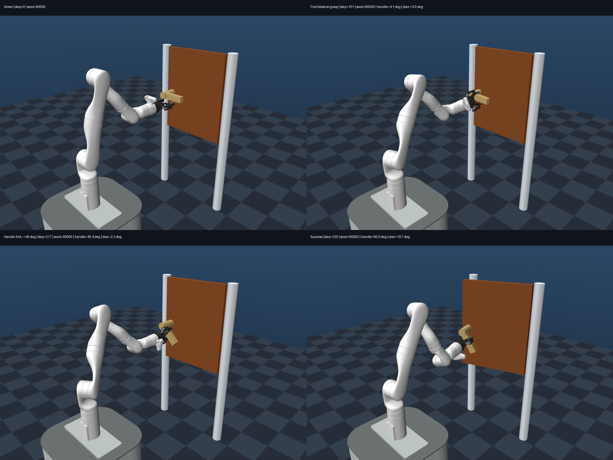

# 当前门模型的 SAC 从零开门训练：脚本、环境与成功经验

记录日期：2026-10-20。本文整理本轮最终可运行的方案；此前探索过程见 [SAC_DOOR_LEARN.md](SAC_DOOR_LEARN.md)，简明使用说明见 [SAC_DOOR_STAGED.md](SAC_DOOR_STAGED.md)。

## 1. 最终结果与适用范围

完整自动入口已经从随机网络训练至 **500000 步**，训练进程正常退出，最终选择本次运行的 **480000 步最佳模型**。
冻结该模型后，在首次使用的 seed **90000..90099**、共 100 个带噪声 home 初始状态中，严格完成开门 **95/100**。
独立逐步物理复核与环境的成功判定在全部 100 回合中一致。

| 验证集合 | 结果 | 含义 |
| --- | --- | --- |
| 480000 步的固定训练选模集 | 5/5 | 用于挑选模型，不是独立测试 |
| 训练结束时自动测试，seed 20000..20004 | 4/5 | 小样本快速检查，1 次穿透失败 |
| 最终冻结模型，seed 90000..90099 | **95/100** | 本次完整冷启动结果的主要独立验证 |
| 早期研究候选，seed 80000..80099 | 98/100 | 另一批状态的历史测试，不能代替本次 95/100 |

最终 100 回合中，seed 90032、90034、90079 未满足连续开门抓握保持条件并超时；seed 90038、90052 触发 `excessive_penetration`。
没有通过放宽穿透限制、缩短保持时间或只统计下压来提高成功率。
结果证明当前门模型、home 扰动和 seed=67 的这套训练配方可以学会任务，不保证任意初态、任意训练种子或不同物理模型都成功。

最终模型：

```text
runs/door_sac_staged_v1/best/best_model.zip
SHA-256: 749cce2111ce2ef347ec47956fe75f6a7ed79316f7aaa7f66c7585d5d644a9e0
```

## 2. 应使用哪些文件

| 文件 | 职责 |
| --- | --- |
| [tests/train_sac_staged.py](../tests/train_sac_staged.py) | **推荐入口**：从随机初始化开始，自动完成两阶段训练、配对检查和最终选模 |
| [tests/train_sac_learn.py](../tests/train_sac_learn.py) | 共用的 SAC 训练、保存、加载、回放转换与评估实现 |
| [src/rlinit/algorithmhand/door_sac_learn_env.py](../src/rlinit/algorithmhand/door_sac_learn_env.py) | 新环境 `SACLearnDoorEnv`、奖励、稳定抓握状态和成功约束 |
| [src/rlinit/algorithmhand/door_sac_learn_replay.py](../src/rlinit/algorithmhand/door_sac_learn_replay.py) | 第二阶段重算自己回放中的 press 奖励，处理恢复训练的回合边界 |
| [tests/inspect_sac_learn.py](../tests/inspect_sac_learn.py) | 保存逐步动作、接触力、关节角、奖励及独立成功复核轨迹 |
| [tests/test_door_sac_learn.py](../tests/test_door_sac_learn.py) | 环境、奖励及实际 SAC 更新/接续检查 |
| [tests/test_door_sac_learn_replay.py](../tests/test_door_sac_learn_replay.py) | 奖励重算、终止/超时和多步回放边界检查 |
| [tests/test_train_sac_staged.py](../tests/test_train_sac_staged.py) | 自动入口、周期文件配对和模型选择检查 |

原 `tests/train_sac_open.py`、原环境及本轮开始时的门模型保留。`door_sac_continuous_env.py` 等文件是探索分支，不是此次验证成功的推荐环境。
不要直接运行 `train_sac_learn.py` 的裸默认参数来声称复现成功配方：其默认配置与推荐两阶段入口不同；`train_sac_staged.py` 显式使用 guided 奖励和从一开始就启用的三步回报。

## 3. 环境、动作与成功标准

### 3.1 原始关节动作保持不变

- 动作仍为 **8 维**：7 个机械臂关节增量和 1 个夹爪动作。
- 机械臂目标更新仍为原实现的 `arm_target += 0.01 * action[:7]`，随后使用原有关节目标限位。
- 夹爪目标仍由 `(action[7] + 1) / 2 * 170` 映射。
- 新环境没有重写原 `DoorEnv.step` 或 `_apply_controls`，保留原生执行器和已有重力/偏置补偿。
- 没有新增 IK、雅可比映射、规划器、自动抓取、开门轨迹或控制器；动作由 SAC 策略产生。
- 每回合从原 home 加幅度为 0.02 的关节初态噪声开始，没有示范、预抓握状态库或中间状态重置。

观测从原开门环境的 78 维扩展至 **80 维**，新增稳定抓握时长比例和“曾经稳定下压完成”标志。
这使策略能够观察决定奖励与任务阶段的记忆状态。

### 3.2 当前门模型

场景为 `models/door_scene.xml`，门夹具为 `models/objects/door_lock_fixture.xml`。
门铰链与把手均为被动关节，机械臂通过真实接触施力，没有直接控制门或把手的执行器。

| 项目 | 当前设置 |
| --- | --- |
| 把手活动范围 | 下压 0..60°，下限禁止上拉至水平以上 |
| 把手恢复弹簧 | `stiffness=1`，`springref=0` |
| 把手关节摩擦/阻尼 | `frictionloss=0.1`，`damping=0` |
| 门铰链范围 | 0..0.4 rad，约 0..22.9° |
| 门铰链摩擦/阻尼 | `frictionloss=1`，`damping=1` |
| 奖励与稳定下压目标 | 45°，即 `pi/4` |

按当前门舌几何检查，首次几何净空约在 42.35°，45°时约有 1.7 mm 净空余量。这是特定模型的几何结果，不能泛化为任何门的解锁角。
达到 45°只是下压与门舌释放目标，**不能保证已经打开门**；策略仍需要维持接触并向后拉动门板。
MuJoCo 关节限位为数值约束，记录角度可能有小幅越限，不应将瞬时角度越限当作成功依据。

### 3.3 严格任务判定

1. 双侧夹爪对把手形成真实法向接触，达到原接触阈值 0.05 N。
2. 连续双侧抓握至少 **0.10 秒**，且把手下压达到 **45°**，记录稳定下压完成。
3. 此后在双侧抓握状态下，门角达到 **0.30 rad，约 17.2°**，连续保持至少 **0.30 秒**。
4. 过程中无物理失败。原有穿透超过 **5 mm**、不安全碰撞和数值异常等失败规则保留。

下压和拉门可以在真实运动中交叠，上述条件是判定规则，不是控制器强制执行的动作阶段。
仅出现 `press_seen`、单帧下压角或门角越过阈值，都不能代替完整成功。

## 4. 为什么分两阶段，奖励如何变化

两阶段始终使用 **同一个 SAC 算法和网络结构**。第二阶段保留本次第一阶段的网络、优化器及均匀在线回放，改变的是 press 奖励形式。

### 4.1 第一阶段：前 100000 步，先获得稳定下压经验

使用 `LearnRewardConfig.guided()`，保留原环境的距离、平衡、居中、姿态、提前闭合、接触和抓握引导。
主要调整包括：

- 未形成双侧抓握时，对基础奖励加入 `noncontact_cap`，使其合计不高于每步 -0.01，抑制空夹悬停持续获得正分的漏洞。
- 下压项由真实双侧抓握、抓握稳定程度和下压角决定，**不再额外乘姿态质量的四次方**。
- 完整成功奖金设为 2000，失败惩罚为 100，突出真正完成任务。
- 首次下压里程碑项仍保留，系数为 3；开门项系数为 2，受真实抓握和已完成稳定下压标志约束。

定义 `g` 为双侧抓握标志，`s = min(连续抓握时长 / 0.10秒, 1)`，`p = clip(下压角 / 45°, 0, 1)`，第一阶段的持续下压项为：

```text
r_press = 3 * g * s * p
```

它能在早期提供密集学习信号，但持续压住不拉门也能反复获得这部分奖励。因此它适合积累下压经验，不宜把高 press 奖励当成已学会完整开门。

### 4.2 第二阶段：后 400000 步，将持续下压奖励改为进度奖励

设置 `press_progress_only=True`，移除上面的持续下压项，加入折扣势能差：

```text
Phi(state) = 12 * s * p                 尚未完成稳定下压时
Phi(state) = 12                         曾完成稳定下压后，该标志保持至回合结束
r_press_progress = gamma * Phi(next) - Phi(current)
gamma = 0.995
```

该项按进度变化支付奖励，减少靠停在压把手状态或反复压放持续收取同一笔正奖励的诱因。
势能保持为 12 时，该项每步为 -0.06，不是继续领取正的下压奖励。
真正终止时下一状态势能取零；时间限制截断保留 bootstrap。进度项放在 `noncontact_cap` 之外。
两个阶段其余奖励权重、动作接口、物理和成功标准保持一致。

这套两阶段组合已被实际复现，但本轮不是严格单变量消融实验，不能据此证明任意一个设置都是成功的唯一原因，也没有证明单阶段 SAC 一定无法完成任务。

### 4.3 必须同步转换自己的回放

奖励切换后，已有转移的 press 部分必须按新规则重算，否则旧奖励与新奖励会混入同一个训练目标。
`door_sac_learn_replay.py` 使用观测内的下压角、稳定抓握比例和完成标志转换奖励，不编造动作、状态或成功样本。
回放仍是本次训练采集的均匀在线回放，没有优先经验、HER 或外部示范。

恢复训练会从新 home 开始，因此将旧回放末尾未完成的 4 个环境片段标记为 timeout，保留其 next state 和 bootstrap，防止三步回报跨接到不相关的新回合。

## 5. 成功配方的训练参数与接续边界

| 参数 | 最终验证配方 |
| --- | --- |
| 算法 | Stable-Baselines3 SAC，`MlpPolicy` |
| 网络 | `[256, 256]`，ReLU |
| 总环境转移数 | 500000；第一阶段 100000，第二阶段再训练 400000 |
| 随机种子 / 并行环境 | seed=67，4 环境，worker seeds=67..70 |
| 学习率 / batch / replay 容量 | `1e-4` / 256 / 300000 |
| gamma / tau / 固定熵系数 | 0.995 / 0.005 / 0.005 |
| 多步回报 | **从训练开始使用 3-step**，不是 40 万步后才切换 |
| 初始随机采样 | 前 5000 步；接续阶段直接继续更新 |
| 更新频率 | `train_freq=1`，`gradient_steps=-1`，每轮向量采样后更新次数等于该轮转移数 |
| 额外探索噪声 | 仅夹爪 OU，目标稳态标准差 0.3；手臂 7 维额外 OU 为零 |
| OU 实现参数 | 夹爪 `sigma=sqrt(2)*0.3`，`theta=1`，`dt=0.02` |
| 设备 / PyTorch 线程 | 第一阶段 CUDA，第二阶段 CPU；线程数 1 |
| 评估频率 | 每新增 10000 步，固定 5 回合选模 |
| 周期模型与回放 | 每 20000 步保存；最佳模型另行保留 |

CUDA→CPU 是实际成功实验验证过的运行组合，**不是 SAC 算法必须换设备**。
CPU-only、不同 GPU 或不同软件版本可能产生不同数值轨迹，不能承诺相同 seed 在不同硬件上逐位复现。

第一阶段必须使用同一次周期回调保存的 `latest_model.zip` 与 `latest_replay_buffer.pkl` 配对。
SB3 的周期回调发生在当前向量转移写入回放和梯度更新之前，默认边界如下：

| 文件边界 | 模型计数 | 梯度更新数 | 回放转移数 |
| --- | ---: | ---: | ---: |
| 成功配方使用的周期配对 | 100000 | 94996 | 99996 |
| 第一阶段正常结束后的 final 文件 | 100000 | 95000 | 100000 |

二者不是同一个数值边界。`train_sac_staged.py` 会检查周期模型计数、环境数与回放大小，不应手工换成 final 文件后声称精确复现同一配方。
完整冷启动运行的前缀、有效回放数组以及后续 150000、370000、480000 步网络/优化器状态均已直接比对成功研究路线，确认自动入口实际复现了接续。

验证时的软件版本：Python 3.14.8、SB3 2.9.0、PyTorch 2.11.0+cu128、MuJoCo 3.15.0、NumPy 2.5.3；硬件为 RTX 3060 12GB、6 核 12 线程 CPU、32GB 内存。

## 6. 从零训练与验证命令

以下命令均在仓库根目录执行，使用已安装好的项目依赖。训练输出目录必须为空；已有成功运行保存在 `runs/door_sac_staged_v1`，不要覆盖。

从零训练一套新的网络：

```powershell
uv run --no-sync python tests/train_sac_staged.py --seed 67 --n-envs 4 --timesteps 500000 --press-progress-after 100000 --device cuda --opening-device cpu --output-dir runs/door_sac_staged_reproduce
```

查看最终交付模型的独立评估结果，并复现已记录的 100 个初态：

```powershell
uv run --no-sync python tests/train_sac_staged.py --evaluate runs/door_sac_staged_v1/best/best_model.zip --episodes 100 --seed 90000 --device cpu
```

渲染观看策略：

```powershell
uv run --no-sync python tests/train_sac_staged.py --evaluate runs/door_sac_staged_v1/best/best_model.zip --episodes 5 --seed 90000 --device cpu --render
```

保存完整逐步物理复核轨迹：

```powershell
uv run --no-sync python tests/inspect_sac_learn.py runs/door_sac_staged_v1/best/best_model.zip --episodes 100 --seed 90000 --device cpu --output runs/door_sac_staged_recheck.json
```

90000 系列现已用于本次测试，重复它们是复现检查，不能再称为一批从未使用的新测试状态。
推荐入口的 `--render` 用于评估，不能附在这套四环境训练命令后要求训练时渲染。

## 7. 成功经验与容易误判的地方

1. **先验证物理可行性，再谈 reward 阈值。** 当前 45°与门舌净空相容，60°是把手活动上限；解锁角与实际拉开门是两回事。旧双向把手模型的 97/100 不能直接证明当前模型也能训练成功。
2. **保留有效的接近/抓握梯度，并检查奖励漏洞。** 只使用局部、易饱和的势能或重新组合线性成本的早期分支，没有在其观察预算内形成成功交付；guided 方案保留原引导，并对未抓握悬停的净正奖励封顶。不能把单个失败实验概括为某类奖励普遍无效。
3. **压把手的奖励要服务于拉门。** 第一阶段用持续奖励积累实际接触下压；第二阶段以进度势能替换持续收益，同时保留开门和完整成功信号。稳定抓握后的旋转奖励不再被姿态质量四次方大幅削弱。
4. **经验积累、奖励切换和回放一致性一起处理。** 不清空自己采集的有效经验，也不让旧奖励标签继续训练新任务；检查终止、超时及多步回报边界。
5. **按完整任务指标保留最佳模型。** 训练内固定评估在 400000 步首次达到 5/5，430000 步降至 2/5，460000 步降至 0/5，之后恢复。reward 和成功率都可能退化，不能只交付最后一步模型。
6. **小样本、单帧角度和截图都不足以证明稳定成功。** 固定 5/5、独立快速 4/5 和新 100 回合的 95/100 可以同时成立；需要冻结模型、记录测试种子，并逐步复核真实接触与保持时长。
7. **不要把未经验证的改动混入成功配方。** 增加手臂 OU、移除部分关节软件限位等探索分支没有给出优于最终方案的证据；最终成功环境仍保留原动作与限位。设备变化的影响也没有通过严格消融证明。
8. **区分实验进度和已完成结果。** 最终方案在 320000 步才首次出现固定完整成功 1/5，早期 press 很高但 full=0 不等于已经学会开门；也不能凭早期零成功断言后续一定失败。

## 8. 结果与证据文件

实际成功运行的目录结构：

```text
runs/door_sac_staged_v1/
  pipeline.json                    # 从零模式、自己的阶段来源、完整预算及所选模型 SHA
  best/best_model.zip              # 最终交付的 480000 步模型
  best/selection.json              # 选模指标
  evaluation.json                 # 入口自动快速测试，4/5
  phase1/                         # 随机起点、配置、周期模型和自己的回放
  phase2/                         # 接续配置、训练日志、评估历史及最终模型/回放
  source/                         # 训练源码及 XML 归档
  prefix_reproduction_audit.json
  continuation_150k_audit.json
  continuation_370k_audit.json
  continuation_480k_audit.json
  interface_audit.json
  completion_audit.json            # 13 项完成检查全部通过
  verification/
    heldout_seed90000_100episodes.json
    heldout_seed90000_summary.json   # 上传的逐回合摘要，不含大型逐步轨迹
    visual_seed90000/sequence.png
    visual_seed90000/evidence.json
```

最终交付 ZIP 与冻结后做 100 回合测试的文件逐字节一致。
检查点记录任务格式、奖励参数和场景/门夹具/机器人 XML 哈希，模型改变后应重新验证，不能静默复用旧模型或回放冒充新任务训练。
仓库保留上述最佳模型、配置、选模/审计记录、训练源码归档、截图和 `heldout_seed90000_summary.json`。
摘要保留全部 100 回合的成功/失败结果、模型哈希及完整轨迹文件哈希；大型回放、其他检查点和 87 MB 的逐步轨迹仅保留本地，需用复核命令重新生成或另行迁移。
不要将精简发布包误认为可以直接恢复训练的完整回放备份。
根目录 `.gitattributes` 固定了三个被校验 XML 的原有换行格式，并保持源码归档字节不变，避免跨平台 Git 换行转换使相同物理模型无法通过检查点哈希校验。

选中的 seed=90000 成功展示回合：step101 首次双侧抓握，step217 稳定下压 45.437°，step325 完整成功，门角约 19.667°。
它展示真实 MuJoCo 策略动作；总体性能结论仍来自上述全部 100 回合。


